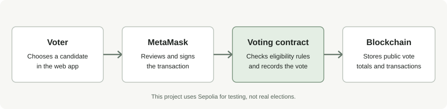

# Blockchain Voting App

I built this project to learn more about Solidity and how a smart contract connects to a website. You can create an election with a fixed list of candidates, connect a wallet, and vote. The contract keeps track of the votes on the blockchain.

The project uses Sepolia for testing and has an optional Alchemy gas sponsorship flow. This is still a learning project, not something to use for a real election.

## How voting works



- Creates an election with a title, candidates, and a deadline.
- Lets a wallet vote once in that election.
- Rejects votes for candidates that don't exist and votes after the deadline.
- Keeps vote totals on-chain, so anyone can read them.
- Includes Foundry tests for the contract.
- Uses a React and TypeScript frontend with MetaMask.
- Can request gas sponsorship through Alchemy Wallet APIs when the Sepolia policy is configured.

The contract is responsible for enforcing the voting rules. The frontend makes it easier to use, but it isn't what prevents someone from voting twice.

## Tech used

- Solidity
- Foundry (`forge`, `cast`, and `anvil`)
- React, TypeScript, and Vite
- MetaMask
- Alchemy RPC and optional gas sponsorship
- GitHub Actions for builds and tests

## How the parts fit together

The contract in `src/Voting.sol` stores the election and checks each vote. Foundry is used to build, test, and deploy it. The frontend in `frontend/` reads the contract and lets someone connect MetaMask and submit a vote.

When someone votes, MetaMask asks them to approve the transaction. If Alchemy sponsorship is set up and the transaction matches the policy, Alchemy may cover the gas fee. Sponsorship is optional and isn't guaranteed for every transaction.

For a closer look at the code, see [the code walkthrough](docs/CODE_WALKTHROUGH.md).

## Run the contract tests

You'll need [Foundry](https://book.getfoundry.sh/getting-started/installation). From the repository root, run:

```bash
forge install foundry-rs/forge-std
forge build
forge test -vv
forge fmt --check
```

The first command installs the test library used by this project. You only need to do that once for your local checkout.

## Run the frontend

You'll need Node.js 20 or newer and MetaMask. From the repository root:

```bash
cd frontend
npm install
cp .env.example .env.local
```

Open `frontend/.env.local` and set the RPC URL, chain ID, and contract address. Then start the dev server:

```bash
npm run dev
```

For local development, you can use Anvil. For the Sepolia setup and optional gas sponsorship, follow [the frontend instructions](frontend/README.md).

You need a deployed contract address for the frontend to show an election. There isn't a live demo link yet because the frontend and contract need to be configured and deployed separately.

## A few things to know

- This app doesn't make votes private. Wallet addresses, transactions, and results are public on the blockchain.
- A wallet address doesn't prove who someone is or whether they're allowed to vote. One person can use multiple wallets.
- Candidates and the deadline are set when the contract is deployed.
- Gas sponsorship depends on an active Alchemy policy and its limits.
- The contract hasn't been professionally audited, so don't use it for a real election.

## Project layout

```text
src/Voting.sol                 Voting rules and on-chain data
test/Voting.t.sol              Contract tests
script/DeployVoting.s.sol      Example deployment script
frontend/src/App.tsx            Main page and voting flow
frontend/src/contract.ts        Contract connection and configuration
frontend/src/sponsoredVoting.ts Optional Alchemy-sponsored voting
docs/CODE_WALKTHROUGH.md        Explanation of how the code works
.github/workflows/ci.yml        Automated checks
```

## License

MIT
